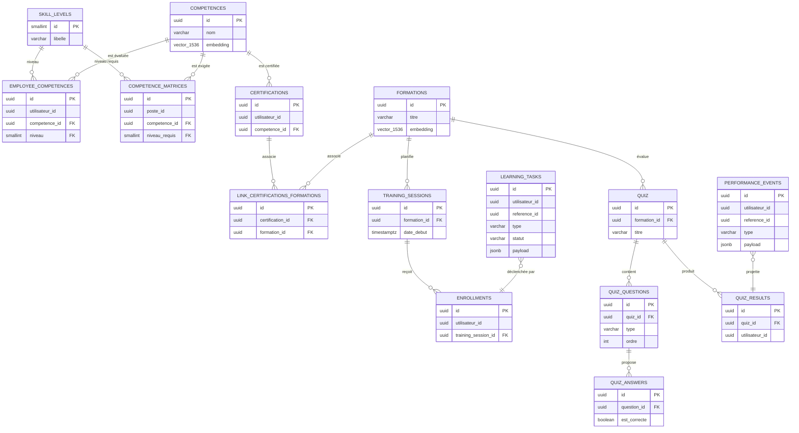

# Schéma ER PostgreSQL

## Index et contraintes

- `competences.embedding vector(1536)` et `formations.embedding vector(1536)` sont destinés à pgvector. `idx_competences_embedding` est un index `ivfflat` avec `vector_cosine_ops` et `lists = 100`; il accélère les recherches de similarité cosinus.
- `employee_competences(utilisateur_id, competence_id)` et `competence_matrices(poste_id, competence_id)` sont uniques. Ils empêchent le doublonnage d'une évaluation ou d'une exigence de poste.
- Les index ciblent les clés de jointure et filtres : `employee_competences.utilisateur_id`, `employee_competences.competence_id`, `competence_matrices.poste_id`, `competence_matrices.competence_id`, les clés de certifications, sessions, inscriptions, quiz, questions, réponses et résultats.
- Les relations qui dépendent fonctionnellement d'une compétence, formation, session, quiz ou question utilisent `ON DELETE CASCADE`.

Les migrations de référence sont `migrations/001_schema_competences.sql`, `002_schema_formations.sql` et `migration_quiz_complete.sql`.
